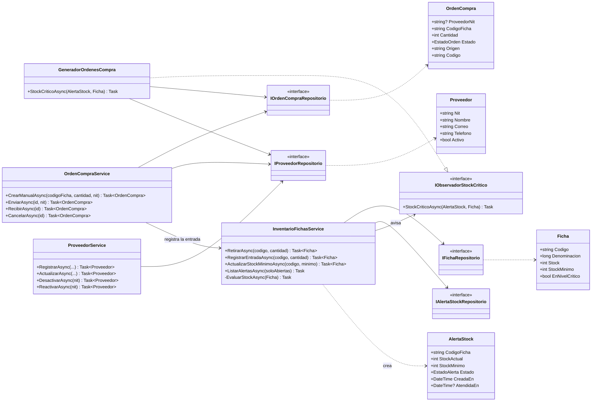
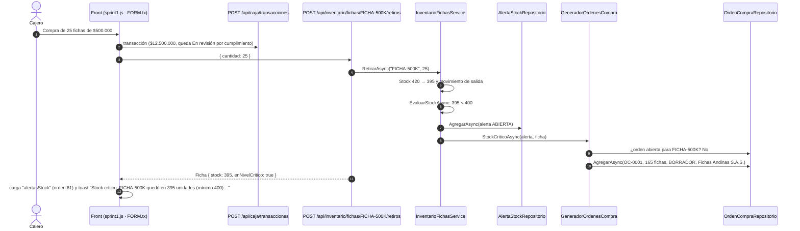

# 5.x Bloque Inventario de fichas y Compras (HU-05)

> arc42 §5 · Vista de bloques, nivel 2. Dueño: Camilo. Historias: HU-05 *Alerta de Stock Crítico* (5 SP, CER-14) y *CRUD de Proveedores y orden de compra automática* (3 SP, CER-15). Decisiones relacionadas: D-001 (adaptación al casino), D-002 (monolito modular) y D-004 (extensión sin conflictos). Contrato propio: C8.

## 1. Propósito y frontera

El bloque guarda el inventario de fichas de la bóveda por denominación, con un **stock mínimo** por denominación. Cuando una operación deja el stock por debajo de ese mínimo, el sistema abre una **alerta de stock crítico** y genera automáticamente un **borrador de orden de compra** a un proveedor registrado. Al recibir la orden, el stock se repone y la alerta se cierra sola.

Son dos módulos del monolito con una dependencia en un solo sentido: **Compras depende de Inventario, Inventario no conoce a Compras.**

| Capa | Carpeta / archivo | Contenido |
|---|---|---|
| Dominio | `src/CasinoErp.Dominio/Inventario/` | `Ficha` (con `StockMinimo` y `EnNivelCritico`), `MovimientoInventario`, `IFichaRepositorio`, `AlertaStock`, `EstadoAlerta`, `IAlertaStockRepositorio`, `IObservadorStockCritico` (contrato C8), `InventarioFichasService` |
| Dominio | `src/CasinoErp.Dominio/Compras/` | `Proveedor`, `IProveedorRepositorio`, `ProveedorService`, `OrdenCompra`, `EstadoOrden`, `IOrdenCompraRepositorio`, `GeneradorOrdenesCompra`, `OrdenCompraService` |
| Infraestructura | `Configuraciones/AlertaStockConfiguracion.cs`, `Configuraciones/ComprasConfiguracion.cs` | Tablas `AlertasStock`, `Proveedores` (NIT único) y `OrdenesCompra` |
| Infraestructura | `Repositorios/InventarioRepositorios.cs`, `Repositorios/ComprasRepositorios.cs` | Adaptadores EF Core |
| Infraestructura | `Modulos/ModuloCompras.cs` | Registro en el contenedor de DI (incluido el observador) |
| Infraestructura | `Semillas/SemillaUmbralesInventario.cs` (orden 5), `Semillas/SemillaCompras.cs` (orden 30) | Mínimo de 400 para `FICHA-500K` (demo) y dos proveedores |
| Api | `Controllers/InventarioController.cs`, `ProveedoresController.cs`, `ComprasController.cs` | Endpoints REST |
| Front | `wwwroot/js/api/inventario.js`, `wwwroot/js/api/compras.js` | Pantallas **Inventario de fichas** y **Proveedores y compras** |

### Lo que expone

| Verbo y ruta | Qué hace | Respuesta |
|---|---|---|
| `PUT /api/inventario/fichas/{codigo}/minimo` | Cambia el stock mínimo de una denominación | "Stock mínimo actualizado" |
| `GET /api/inventario/alertas?soloAbiertas=true` | Alertas de stock (abiertas o todas), más recientes primero | `AlertaStock[]` |
| `GET /api/proveedores?soloActivos=` | Lista los proveedores | `Proveedor[]` |
| `GET /api/proveedores/{nit}` | Consulta uno | `Proveedor` (404 si no existe) |
| `POST /api/proveedores` | Registra | 201 · "Proveedor registrado" |
| `PUT /api/proveedores/{nit}` | Nombre, correo y teléfono (el NIT de la ruta manda) | "Proveedor actualizado" |
| `POST /api/proveedores/{nit}/desactivar` · `/reactivar` | Borrado lógico y su reverso | "Proveedor desactivado" · "Proveedor reactivado" |
| `GET /api/compras/ordenes` | Órdenes, más recientes primero | `OrdenCompra[]` (incluye `codigo`, p. ej. `OC-0001`) |
| `POST /api/compras/ordenes` | Orden manual en borrador | 201 · "Orden de compra creada" |
| `POST /api/compras/ordenes/{id}/enviar` | Borrador → Enviada (puede asignar el proveedor) | "Orden enviada" |
| `POST /api/compras/ordenes/{id}/recibir` | Enviada → Recibida; registra la entrada en la bóveda | "Orden recibida" |
| `POST /api/compras/ordenes/{id}/cancelar` | Borrador o Enviada → Cancelada | "Orden cancelada" |

Las respuestas de `entradas` y `retiros` del inventario (Sprint 1) devuelven la `Ficha`, que ahora incluye `stockMinimo` y `enNivelCritico`. Los enums viajan como `ABIERTA`/`ATENDIDA` y `BORRADOR`/`ENVIADA`/`RECIBIDA`/`CANCELADA` (contrato C7). Errores de negocio: **400**; inexistentes: **404**; sin sesión: **401**; sin permiso: **403**.

**Autorización (contrato C5, tarea C7):**

| Controlador | `[AutorizarModulo(...)]` | Quién entra |
|---|---|---|
| `InventarioController` | `Inventario, Caja` (lo puso Iván en la I5) | Gerente, Jefe de piso, Cajero, Cumplimiento |
| `ProveedoresController` | `Proveedores` | Gerente, Jefe de piso |
| `ComprasController` | `Proveedores, Inventario` | Gerente, Jefe de piso, Cajero (ve y recibe órdenes, pero no administra proveedores) |

### De qué depende

- Inventario: solo de sus repositorios, de `TimeProvider` y de la abstracción `IObservadorStockCritico`.
- Compras: de `InventarioFichasService` (para validar la ficha y registrar la entrada al recibir), de sus repositorios y de `TimeProvider`.

## 2. Diagrama de clases



## 3. Patrón observador y DIP

**Por qué el inventario no depende de Compras.** `InventarioFichasService` solo conoce la interfaz `IObservadorStockCritico`, que vive en su propio namespace (`Dominio/Inventario`). Recibe la lista de observadores por constructor (`IEnumerable<IObservadorStockCritico>`) y, cuando abre una alerta nueva, los recorre. Quién reacciona y cómo es asunto de cada observador. Es el Principio de Inversión de Dependencias: el módulo de alto nivel (el inventario de la bóveda) define la abstracción, y el detalle (Compras) la implementa. Agregar otra reacción, por ejemplo un correo al jefe de piso, es registrar otro observador sin tocar el inventario. Si no hay ninguno registrado, el contenedor inyecta una lista vacía y el inventario sigue funcionando.

**Por qué el generador está separado del servicio de órdenes.** Recibir una orden necesita al inventario (`OrdenCompraService → InventarioFichasService`), y el inventario necesita a sus observadores (`InventarioFichasService → IObservadorStockCritico`). Si el observador fuera el propio `OrdenCompraService`, el contenedor de DI tendría que construir el inventario para construir el servicio de órdenes, y el servicio de órdenes para construir el inventario: un **ciclo** que ASP.NET Core rechaza al arrancar. `GeneradorOrdenesCompra` solo depende de los repositorios de Compras, así que el grafo queda acíclico:

```
OrdenCompraService ──▶ InventarioFichasService ──▶ IObservadorStockCritico ◀── GeneradorOrdenesCompra ──▶ repositorios
```

Cada clase tiene además una sola responsabilidad (SRP): el inventario cuida el stock y sus alertas, el generador decide cuánto pedir y a quién, y el servicio de órdenes gobierna el ciclo de vida de la orden.

## 4. Flujo de la demo (Sprint Review)

Compra de 25 fichas de $500.000 en caja: la bóveda de `FICHA-500K` pasa de 420 a 395, por debajo del mínimo de 400.



Después, en **Proveedores y compras**, el gerente envía y recibe `OC-0001`: `OrdenCompraService.RecibirAsync` llama a `RegistrarEntradaAsync("FICHA-500K", 165)`, el stock sube a 560 y `EvaluarStockAsync` marca la alerta como **ATENDIDA**.

## 5. Reglas

| Regla | Valor |
|---|---|
| Stock mínimo por defecto | 1.000 unidades por denominación (el "umbral 1.000" del mockup); `FICHA-500K` arranca en 400 para la demo |
| Nivel crítico | `Stock < StockMinimo` (quedar exactamente en el mínimo **no** es crítico) |
| Alerta | Una sola alerta abierta por denominación; se actualiza mientras siga bajo el mínimo y pasa a ATENDIDA cuando el stock lo alcanza. Solo la apertura avisa a los observadores |
| Mínimo negativo | "El stock mínimo no puede ser negativo" |
| Cantidad de la orden automática | `max(1, ⌈mínimo × 1,4⌉ − stock actual)`; con 395 y mínimo 400 son 165 |
| Proveedor de la orden automática | El primer proveedor activo (por Id); si no hay, la orden queda sin proveedor |
| Órdenes duplicadas | No se crea otra orden automática si ya hay una en Borrador o Enviada para la misma ficha |
| Transiciones | Borrador → Enviada (Enviar) · Enviada → Recibida (Recibir) · Borrador o Enviada → Cancelada (Cancelar). Otra: "La orden no está en un estado válido para esta acción." |
| Enviar | Exige proveedor: "Asigna un proveedor antes de enviar la orden."; proveedor inactivo: "El proveedor está inactivo." |
| Proveedor | NIT `^\d{9}-\d$` y único; correo en minúsculas; nombre y teléfono obligatorios; se desactiva, no se borra |
| Código de la orden | `OC-` y el Id con cuatro dígitos (`OC-0007`) |

## 6. Pruebas

| Suite | Pruebas | Qué cubre |
|---|---|---|
| `AlertasStockTests` | 11 | Apertura, no duplicado, atención, mínimo exacto, cambio de mínimo, varios observadores |
| `ProveedorServiceTests` | 17 | Validaciones, duplicado, actualización, desactivar y reactivar |
| `OrdenesCompraTests` | 22 | Generador, flujo completo retiro → alerta → orden → recepción, órdenes manuales y transiciones |
| `InventarioComprasApiTests` | 15 | API con SQLite real: umbral de demo, alertas, CRUD de proveedores, órdenes y autorización (401/403) |
