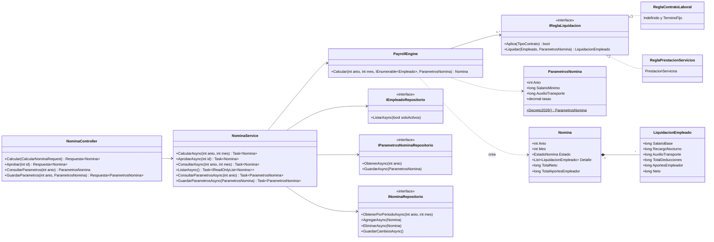
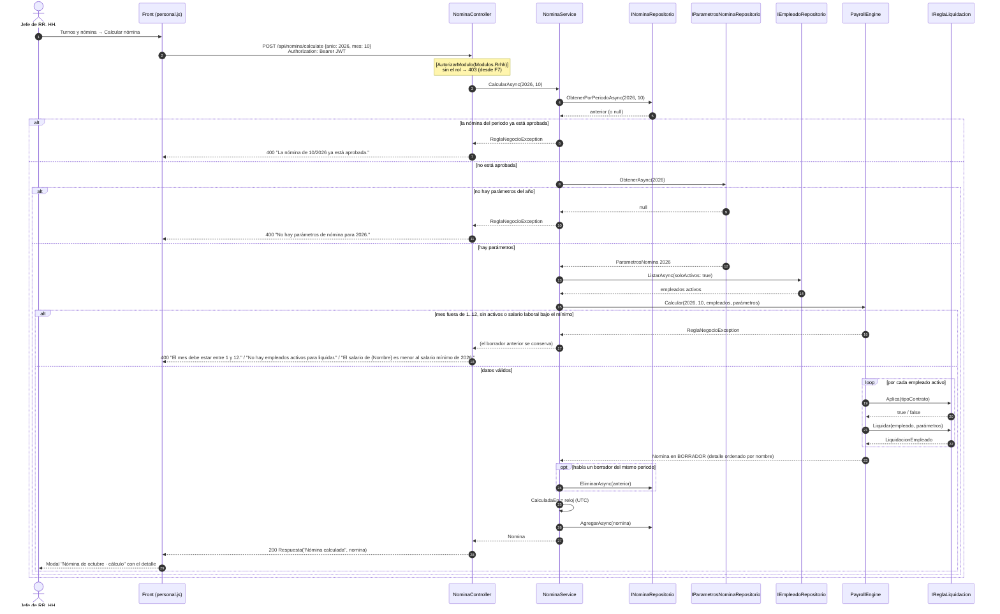

# 5.x Bloque Nómina y Personal (HU-04)

> arc42 §5 · Vista de bloques, nivel 2. Dueño: Felipe. Historia: HU-04 *Cálculo de Nómina* (8 SP). Decisiones relacionadas: [ADR-005](../09-decisiones/ADR-005-parametros-nomina.md), D-002 (monolito modular) y D-003 (parámetros por año).

## 1. Propósito y frontera

El bloque calcula la nómina mensual de los empleados activos del casino, con deducciones y aportes según el tipo de contrato, y administra el CRUD de empleados que la alimenta. Según D-002, es un **módulo aislado dentro del monolito**: tiene sus propias carpetas, interfaces y controladores, y solo depende de otros módulos a través de `IEmpleadoRepositorio`.

| Capa | Carpeta / archivo | Contenido |
|---|---|---|
| Dominio | `src/CasinoErp.Dominio/Personal/` | `Empleado`, `Cargo`, `Turno`, `TipoContrato`, `IEmpleadoRepositorio` (contrato C4), `EmpleadoService` |
| Dominio | `src/CasinoErp.Dominio/Nominas/` | `ParametrosNomina`, `Nomina`, `LiquidacionEmpleado`, `IReglaLiquidacion`, `ReglaContratoLaboral`, `ReglaPrestacionServicios`, `PayrollEngine`, `NominaService` |
| Infraestructura | `Configuraciones/EmpleadoConfiguracion.cs`, `Configuraciones/NominaConfiguracion.cs` | Tablas `Empleados`, `Nominas`, `LiquidacionesNomina`, `ParametrosNomina` |
| Infraestructura | `Repositorios/PersonalRepositorios.cs`, `Repositorios/NominaRepositorios.cs` | Adaptadores EF Core de las tres interfaces de repositorio |
| Infraestructura | `Modulos/ModuloPersonal.cs`, `Modulos/ModuloNomina.cs` | Registro en el contenedor de DI |
| Infraestructura | `Semillas/SemillaPersonal.cs` (orden 10), `Semillas/SemillaNomina.cs` (orden 20) | 18 empleados del mockup y parámetros 2026 |
| Api | `Controllers/EmpleadosController.cs`, `Controllers/NominaController.cs` | Endpoints REST |
| Front | `wwwroot/js/api/personal.js` | Pantallas **Competencias** y **Turnos y nómina** del mockup |

### Lo que expone

| Verbo y ruta | Qué hace | Respuesta |
|---|---|---|
| `GET /api/empleados?soloActivos=` | Lista los empleados | `Empleado[]` |
| `GET /api/empleados/{documento}` | Consulta uno | `Empleado` (404 si no existe) |
| `POST /api/empleados` | Registra | 201 · "Empleado registrado" |
| `PUT /api/empleados/{documento}` | Turno, área, contrato y salario | "Empleado actualizado" |
| `POST /api/empleados/{documento}/retirar` | Borrado lógico con motivo | "Empleado retirado" |
| `POST /api/nomina/calculate` | Calcula la nómina del periodo en borrador | "Nómina calculada" |
| `GET /api/nomina` | Lista las nóminas (año y mes descendentes) | `Nomina[]` |
| `GET /api/nomina/{anio}/{mes}` | Consulta una nómina con su detalle | `Nomina` (404 si no existe) |
| `POST /api/nomina/{id}/aprobar` | Aprueba (ya no se puede recalcular) | "Nómina aprobada" |
| `GET` / `PUT /api/nomina/parametros/{anio}` | Parámetros legales del año (ADR-005) | `ParametrosNomina` · "Parámetros de nómina guardados" |

Los errores de negocio responden **400** y los registros inexistentes **404**, con `{ "mensaje": "..." }`. Los enums viajan en JSON como `CRUPIER`, `NOCHE`, `PRESTACION_SERVICIOS`, `BORRADOR`… (contrato C7). Las propiedades calculadas `totalNeto`, `totalDeducciones`, `totalAportesEmpleador` y `totalRecargos` sí aparecen en el JSON.

**Autorización (contrato C5, tarea F7):** `EmpleadosController` lleva `[AutorizarModulo(Modulos.Competencias, Modulos.Rrhh, Modulos.Mesas)]` y `NominaController` lleva `[AutorizarModulo(Modulos.Rrhh)]`. Se aplican cuando la seguridad de Iván (I5) está en `develop`. Desde ese momento, solo los roles Gerente y Talento Humano pueden calcular o aprobar la nómina.

### De qué depende

- `IEmpleadoRepositorio` (contrato C4, del propio bloque Personal): la nómina solo lee los empleados activos.
- La persistencia (EF Core) a través de `IParametrosNominaRepositorio` e `INominaRepositorio`.
- `TimeProvider` solo en los servicios (fecha de cálculo y aprobación). **El motor no depende de nada externo.**

## 2. Diagrama de clases



Las implementaciones EF Core (`EmpleadoRepositorio`, `NominaRepositorio` y `ParametrosNominaRepositorio`) viven en Infraestructura y se registran en `ModuloPersonal` y `ModuloNomina`. El dominio no las conoce.

## 3. SOLID en el código

### SRP: una sola razón para cambiar por clase

| Clase | Ruta | Su única responsabilidad |
|---|---|---|
| `PayrollEngine` | `Dominio/Nominas/PayrollEngine.cs` | Calcular: valida el periodo y los salarios, elige la regla de cada empleado y arma el borrador. No usa base de datos ni reloj. |
| `NominaService` | `Dominio/Nominas/NominaService.cs` | Orquestar: carga empleados y parámetros, llama al motor, persiste, aprueba. No calcula ningún valor. |
| `ReglaContratoLaboral` | `Dominio/Nominas/ReglaContratoLaboral.cs` | Liquidar contratos laborales (recargo, auxilio, salud, pensión, solidaridad y aportes). |
| `ReglaPrestacionServicios` | `Dominio/Nominas/ReglaPrestacionServicios.cs` | Liquidar prestación de servicios (solo retención del 10 %). |
| `ParametrosNomina` | `Dominio/Nominas/ParametrosNomina.cs` | Guardar los valores legales de un año. |
| `NominaController` | `Api/Controllers/NominaController.cs` | Traducir HTTP ↔ servicio. Sin reglas de negocio. |

Si cambia una tarifa, cambia un parámetro (ADR-005). Si cambia la ley de un tipo de contrato, cambia su regla. Si cambia cómo se guarda la nómina, cambia el repositorio. Ninguno de esos cambios toca el motor.

### DIP: los módulos de alto nivel dependen de abstracciones

El motor recibe las reglas por su interfaz, y el servicio recibe interfaces de repositorio, no EF Core:

```csharp
public class PayrollEngine(IEnumerable<IReglaLiquidacion> reglas) { ... }

public class NominaService(PayrollEngine motor, IEmpleadoRepositorio empleados,
    IParametrosNominaRepositorio parametros, INominaRepositorio nominas, TimeProvider reloj) { ... }
```

Las implementaciones concretas se inyectan en `Infraestructura/Modulos/ModuloNomina.cs`:

```csharp
services.AddSingleton<IReglaLiquidacion, ReglaContratoLaboral>();
services.AddSingleton<IReglaLiquidacion, ReglaPrestacionServicios>();
services.AddSingleton<PayrollEngine>();
services.AddScoped<INominaRepositorio, NominaRepositorio>();
services.AddScoped<IParametrosNominaRepositorio, ParametrosNominaRepositorio>();
services.AddScoped<NominaService>();
```

Gracias a esto, las pruebas unitarias usan repositorios en memoria (`tests/CasinoErp.PruebasUnitarias/Dobles/NominaEnMemoria.cs`) y un `RelojFijo`, sin base de datos.

### OCP: abierto a extensión, cerrado a modificación

Para agregar un contrato nuevo (por ejemplo, **aprendiz SENA**) se hacen dos cosas y **no se modifica `PayrollEngine`**:

1. Crear `ReglaAprendizSena : IReglaLiquidacion` con su `Aplica` y su `Liquidar`.
2. Registrarla en `ModuloNomina.cs` con `services.AddSingleton<IReglaLiquidacion, ReglaAprendizSena>();`.

La prueba `PayrollEngineTests.Un_contrato_nuevo_es_solo_una_regla_mas` lo demuestra: inyecta una regla nueva y el motor la usa sin cambios. Si un tipo de contrato no tiene regla, el motor lanza `InvalidOperationException`, porque es un error de configuración y no de negocio.

## 4. Diagrama de secuencia: `POST /api/nomina/calculate`



Para aprobar (`POST /api/nomina/{id}/aprobar`), el servicio carga la nómina (404 "Nómina no encontrada"), rechaza si ya está aprobada (400 "La nómina ya está aprobada."), y si no, cambia el estado a `APROBADA`, guarda `AprobadaEn` y persiste. El front muestra "Nómina aprobada. Se pagará el 30/10/2026."

## 5. Reglas de liquidación

Parámetros 2026 (ADR-005): salario mínimo **$1.750.905**, auxilio de transporte **$249.095**. Cada valor se redondea a pesos con `MidpointRounding.AwayFromZero`.

**Contrato laboral (indefinido o a término fijo)**

```
recargo     = turno Noche ? R(base × 35 %) : 0
IBC         = base + recargo
auxilio     = IBC ≤ 2 SMMLV ? 249.095 : 0
salud       = R(IBC × 4 %)            pensión = R(IBC × 4 %)
solidaridad = IBC ≥ 4 SMMLV ? R(IBC × 1 %) : 0
aportes     = R(IBC×8,5 %) + R(IBC×12 %) + R(IBC×0,522 %) + R(IBC×4 %) + R(IBC×3 %) + R(IBC×2 %)
neto        = IBC + auxilio − salud − pensión − solidaridad
```

**Prestación de servicios:** `retención = R(base × 10 %)`, `neto = base − retención`. Sin recargo, auxilio, aportes ni restricción de salario mínimo.

Ejemplos tomados de las pruebas (`tests/CasinoErp.PruebasUnitarias/ReglasLiquidacionTests.cs`):

| Caso | Base | Recargo | Auxilio | Salud + pensión | Solidaridad / retención | Neto | Aportes empleador |
|---|---|---|---|---|---|---|---|
| Crupier de tarde (Ana Torres) | 2.600.000 | 0 | 249.095 | 208.000 | 0 | **2.641.095** | 780.572 |
| Crupier de noche (Bruno Lara) | 2.600.000 | 910.000 | 0 (IBC 3.510.000 > 2 SMMLV) | 280.800 | 0 | **3.229.200** | 1.053.772 |
| Jefe de piso | 4.200.000 | 0 | 0 | 336.000 | 0 | **3.864.000** | — |
| Cajero de tarde | 2.300.000 | 0 | 249.095 | 184.000 | 0 | **2.365.095** | — |
| Límite del auxilio | 3.501.810 (= 2 SMMLV) | 0 | 249.095 | — | — | — | — |
| Un peso por encima | 3.501.811 | 0 | **0** | — | — | — | — |
| Límite de solidaridad | 7.003.620 (= 4 SMMLV) | 0 | 0 | — | 70.036 | — | — |
| Salario alto | 8.000.000 | 0 | 0 | 640.000 | 80.000 | **7.280.000** | — |
| Prestación de servicios | 3.000.000 | 0 | 0 | 0 | retención 300.000 | **2.700.000** | 0 |
| Redondeo hacia arriba | 1.750.910 de noche | 612.819 (612.818,5) | — | — | — | — | — |

Bruno Lara y el jefe de piso coinciden con el cálculo del mockup (`payroll()` en `index.html`).

## 6. Pruebas y calidad

| Prueba | Archivo | Cantidad |
|---|---|---|
| Empleados (dominio) | `EmpleadoServiceTests.cs` | 28 |
| Reglas de liquidación | `ReglasLiquidacionTests.cs` | 18 |
| Motor | `PayrollEngineTests.cs` | 14 |
| Servicio de nómina | `NominaServiceTests.cs` | 18 |
| API de empleados y nómina | `tests/CasinoErp.PruebasIntegracion/PersonalNominaApiTests.cs` | 7 + 9 |

Cobertura de líneas (coverlet): `CasinoErp.Dominio` **97,35 %**. `PayrollEngine`, `NominaService`, `ReglaContratoLaboral` y `ReglaPrestacionServicios`: **100 % de líneas y de ramas**. El CI exige ≥ 80 %.
