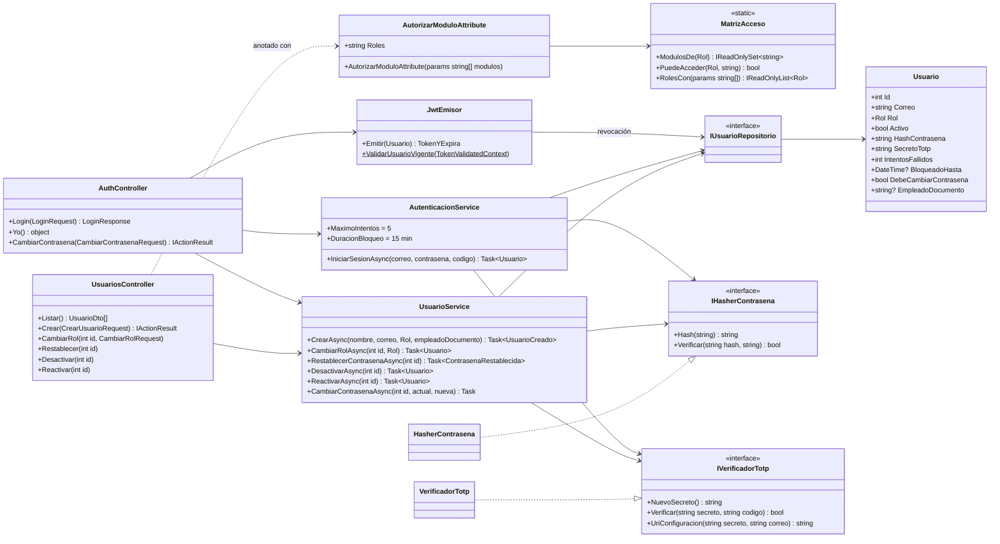
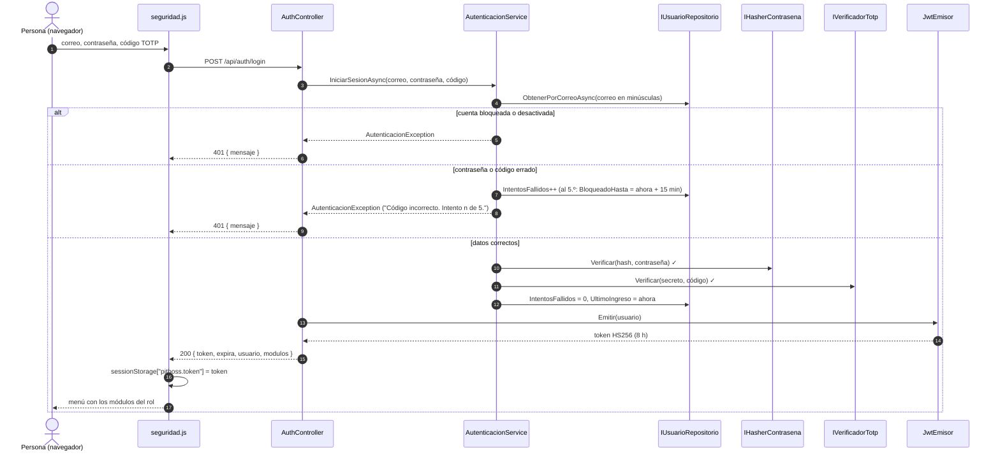
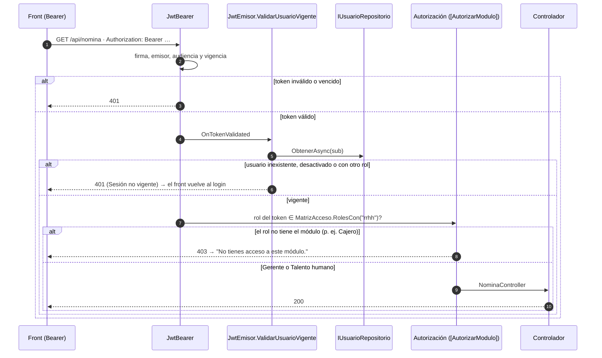

# 5.x Bloque Seguridad: usuarios, roles y control de acceso (HU-06)

> arc42 §5 · Vista de bloques, nivel 2. Dueño: Iván. Historia: HU-06 *Asignación de roles* (5 SP). Conceptos: [§10](../10-conceptos-seguridad.md). Decisión: [ADR-002](../09-decisiones/ADR-002-jwt-totp.md). Contratos C5 y C6.

## 1. Propósito y frontera

El bloque autentica al personal (contraseña y TOTP), emite la sesión (JWT) y decide qué módulos puede usar cada rol. También administra las cuentas: crearlas, asignar o cambiar el rol, restablecer la contraseña, desactivarlas y reactivarlas. Los demás bloques solo dependen de él a través de `Modulos` y `[AutorizarModulo]` (contrato C5).

| Capa | Carpeta / archivo | Contenido |
|---|---|---|
| Dominio | `src/CasinoErp.Dominio/Seguridad/` | `Rol`, `Modulos`, `MatrizAcceso` (C5), `Usuario`, `IUsuarioRepositorio`, `IHasherContrasena`, `IVerificadorTotp`, `ContrasenaTemporal`, `AutenticacionService`, `UsuarioService` |
| Dominio | `Comun/Excepciones.cs` | `AutenticacionException` (→ 401) |
| Infraestructura | `Seguridad/HasherContrasena.cs`, `Seguridad/VerificadorTotp.cs` | Adaptadores de ASP.NET Identity (PBKDF2) y Otp.NET |
| Infraestructura | `Configuraciones/UsuarioConfiguracion.cs`, `Repositorios/SeguridadRepositorios.cs` | Tabla `Usuarios` (correo único) y `UsuarioRepositorio` |
| Infraestructura | `Modulos/ModuloSeguridad.cs`, `Semillas/SemillaSeguridad.cs` (orden 40) | Registro en DI y las 11 cuentas de demo (C6) |
| Api | `Seguridad/OpcionesJwt.cs`, `JwtEmisor.cs`, `AutorizarModuloAttribute.cs`, `UsuarioDto.cs` | Sesión JWT, revocación y autorización por módulo |
| Api | `Controllers/AuthController.cs`, `Controllers/UsuariosController.cs` | Endpoints REST |
| Front | `wwwroot/js/api/seguridad.js` | Login con 2FA, sesión y pantalla **Usuarios y roles** |

### Lo que expone

| Verbo y ruta | Autorización | Respuesta |
|---|---|---|
| `POST /api/auth/login` | Anónimo | 200 `{ token, expira, usuario, modulos }`; 401 `{ mensaje }` |
| `GET /api/auth/yo` | Con sesión | `{ usuario, modulos }` |
| `POST /api/auth/cambiar-contrasena` | Con sesión | "Contraseña actualizada"; 400 si la actual no coincide o la nueva no es segura |
| `GET /api/usuarios` | Módulo `usuarios` | `UsuarioDto[]` |
| `POST /api/usuarios` | Módulo `usuarios` | 201 "Usuario creado" con `{ usuario, contrasenaTemporal, uriTotp }` |
| `PUT /api/usuarios/{id}/rol` | Módulo `usuarios` | "Rol actualizado" |
| `POST /api/usuarios/{id}/restablecer` | Módulo `usuarios` | "Contraseña restablecida" con `{ usuario, contrasenaTemporal }` |
| `POST /api/usuarios/{id}/desactivar` · `/reactivar` | Módulo `usuarios` | "Usuario desactivado" · "Usuario reactivado" |

### De qué depende

- `IEmpleadoRepositorio` (contrato C4, bloque Personal): solo para validar que un usuario Crupier esté vinculado a un empleado con cargo Crupier.
- `TimeProvider` (bloqueos, último ingreso y vigencia del token).
- Configuración: `Jwt:*` y, opcionalmente, `Seguridad:CodigoTotpDemo`.

## 2. Diagrama de clases

## 3. Login con 2FA

## 4. Petición autorizada o denegada

## 5. Pruebas que cubren el bloque

| Nivel | Archivo | Qué verifica |
|---|---|---|
| Unitaria | `MatrizAccesoTests` | La matriz del mockup, `PuedeAcceder` y `RolesCon` |
| Unitaria | `AutenticacionServiceTests` | Login, mensajes, bloqueo y vencimiento, contraseñas temporales seguras |
| Unitaria | `UsuarioServiceTests` | Alta, validaciones, crupier vinculado, último administrador, restablecer, cambiar la contraseña |
| Integración | `SeguridadApiTests` | Semilla de 11 cuentas, TOTP real, 401/403 por rol, revocación por desactivación o cambio de rol, sin secretos en las respuestas |
| Manual (I6.2) | `js/api/seguridad.js` | Los 9 escenarios del plan en el navegador |
