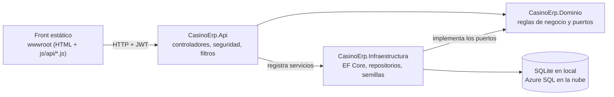

# 5. Vista de bloques

## Nivel 1: el sistema completo

PitBoss ERP es un **monolito modular en capas** (ver [ADR-001](09-decisiones/ADR-001-monolito-modular.md)). El front es el mockup HTML/JS servido por la propia API.

La dependencia apunta siempre hacia el dominio: `Dominio` no conoce a `Api` ni a `Infraestructura` (DIP). Las interfaces de repositorio viven en el dominio y la infraestructura las implementa.

| Capa | Proyecto | Responsabilidad |
|---|---|---|
| Front | `src/CasinoErp.Api/wwwroot` | Pantallas del mockup; `js/api/*.js` las conecta con la API (un archivo por módulo). |
| API | `CasinoErp.Api` | Controladores, manejo de errores (`FiltroExcepciones`), autenticación y autorización. |
| Dominio | `CasinoErp.Dominio` | Entidades, servicios de negocio, excepciones y puertos (interfaces). |
| Infraestructura | `CasinoErp.Infraestructura` | `CasinoErpDbContext`, configuraciones de EF, repositorios, semillas de demo y el registro de servicios por módulo. |

## Nivel 2: bloques (módulos) del dominio

| Bloque | Carpeta del dominio | Sprint | Documentación |
|---|---|---|---|
| Jugadores (perfiles) | `Jugadores` | 1 | — |
| Mesas (catálogo y operación) | `Mesas` | 1 | — |
| Caja / POS | `Caja` | 1 | — |
| Retención | `Retencion` | 1 | — |
| Rellenos y bóveda | `Rellenos` | 1 | — |
| Inventario de fichas, alertas y compras | `Inventario`, `Compras` | 1 y 2 | [05-bloques/inventario-compras.md](05-bloques/inventario-compras.md) (Camilo) |
| Personal y Nómina | `Personal`, `Nominas` | 2 | [05-bloques/nomina.md](05-bloques/nomina.md) (Felipe) |
| Seguridad (usuarios, roles, 2FA) | `Seguridad` | 2 | [05-bloques/seguridad.md](05-bloques/seguridad.md) (Iván) |
| Comunes | `Comun` | 1 | Excepciones de negocio (`ReglaNegocioException`, `NoEncontradoException`) y utilidades de dinero (`Pesos`). La respuesta `Respuesta<T>` vive en la API. |

## Cómo se agrega un módulo sin tocar los demás (D-004)

Cada módulo aporta tres piezas propias y no edita archivos compartidos:
- una clase `IEntityTypeConfiguration<T>` en `Infraestructura/Configuraciones/` (cargada por `ApplyConfigurationsFromAssembly`);
- su método `Agregar<Modulo>()` en `Infraestructura/Modulos/Modulo<Nombre>.cs` para registrar sus servicios;
- una `ISemilla` en `Infraestructura/Semillas/` con sus datos de demo.

> Los archivos `05-bloques/*.md` los escribe cada dueño (Felipe, Camilo e Iván) y aún no están en `develop`.
