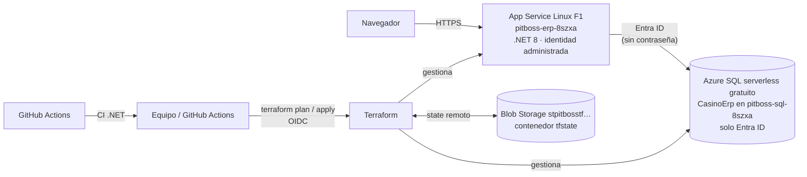

# 7. Vista de despliegue

## En la nube (Azure)

Todos los recursos están en la región Brazil South. El código de Terraform está en `infra/terraform/` (ver [ADR-003](09-decisiones/ADR-003-terraform-azure.md)).

| Nodo | Recurso Terraform | Configuración | Secretos |
|---|---|---|---|
| Grupo de recursos | `azurerm_resource_group.principal` | `rg-pitboss-erp` | — |
| App Service | `azurerm_linux_web_app.erp` en `azurerm_service_plan.principal` | F1, .NET 8, `always_on = false`, identidad `SystemAssigned`, `TZ=America/Bogota` | `Jwt__Clave` es un app setting que genera `random_password.jwt`; no hay contraseñas SQL |
| Azure SQL | `azurerm_mssql_server.principal` y `azurerm_mssql_database.erp` | Oferta gratuita serverless, `azuread_authentication_only = true`, reglas de firewall | La identidad administrada entra con `Authentication=Active Directory Default` |
| State de Terraform | `bootstrap/` (`azurerm_storage_account.tfstate`) | `rg-pitboss-tfstate`, contenedor privado `tfstate`, sin claves de acceso | Se accede con Entra ID (`use_azuread_auth`) |
| CI | `.github/workflows/ci.yml` y `terraform-plan.yml` | Pruebas y cobertura ≥ 80 %; `plan` en cada PR a `develop` | OIDC con la identidad administrada `id-github-pitboss-terraform`: secretos `AZURE_CLIENT_ID`, `AZURE_TENANT_ID`, `AZURE_SUBSCRIPTION_ID`, `TFSTATE_RG`, `TFSTATE_SA` |

## En local

`dotnet run --project src/CasinoErp.Api` levanta el front en http://localhost:5080 y Swagger en `/swagger`, con SQLite (`casino-erp.db`).

| Aspecto | Local | Nube |
|---|---|---|
| Base de datos | SQLite, `EnsureCreated` | Azure SQL, `EnsureCreated` (ADR-004) |
| Proveedor (`BaseDatos__Proveedor`) | `Sqlite` | `SqlServer` |
| Código TOTP de demo (`Seguridad__CodigoTotpDemo`) | El que se configure en `appsettings` o el entorno | Vacío, salvo durante la Sprint Review |
| Recrear la base (`BaseDatos__RecrearAlIniciar`) | `$env:BaseDatos__RecrearAlIniciar="true"` | `true` solo en el despliegue del Sprint 2; después `false` |

## Procedimiento de despliegue del Sprint 2

1. Todos los PR de HU-04, HU-05 y HU-06 están en `develop` con el CI en verde.
2. `terraform -chdir=infra/terraform apply -var="recrear_base_al_iniciar=true" -var="codigo_totp_demo=<código>"`.
3. Publicar: `dotnet publish src/CasinoErp.Api -c Release -o publish`, `Compress-Archive publish\* publish.zip -Force` y `az webapp deploy -g rg-pitboss-erp -n pitboss-erp-8szxa --src-path publish.zip --type zip`.
4. Prueba de humo: `GET /api/salud` responde 200; login y cálculo de nómina como Felipe; login como Laura (solo ve Caja e Inventario). La primera carga puede tardar un minuto porque la base gratuita se reanuda.
5. Volver a `recrear_base_al_iniciar=false` con un nuevo `apply` y comprobar que `terraform plan` no deja cambios.

> Estado (2026-11-18): el bootstrap del state está aplicado (`rg-pitboss-tfstate`, `stpitbosstfjfie3s`) y la infraestructura existente está importada en el state remoto. El `terraform plan` solo propone crear la clave JWT y agregar los app settings nuevos. Falta aplicarlo en el despliegue del Sprint 2 (J6). La identidad del workflow es una identidad administrada con credencial federada (`id-github-pitboss-terraform`), porque el directorio de la universidad no permite registrar aplicaciones.
